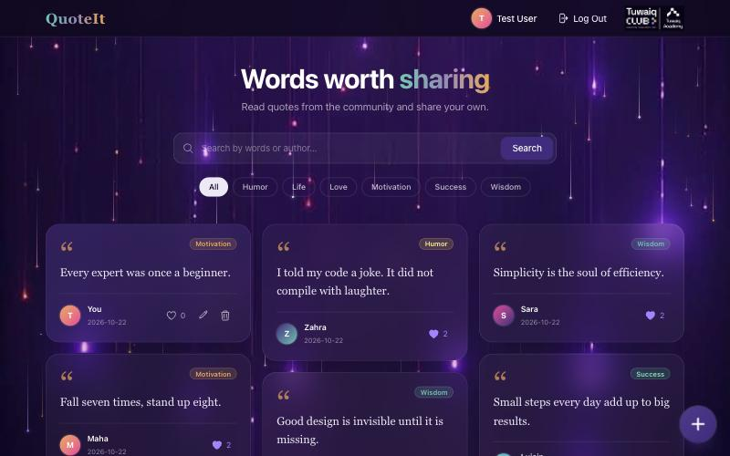
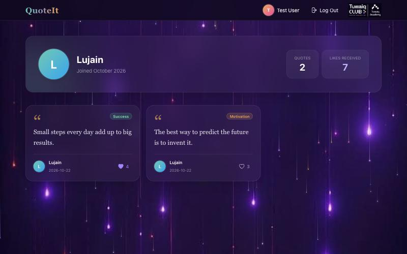
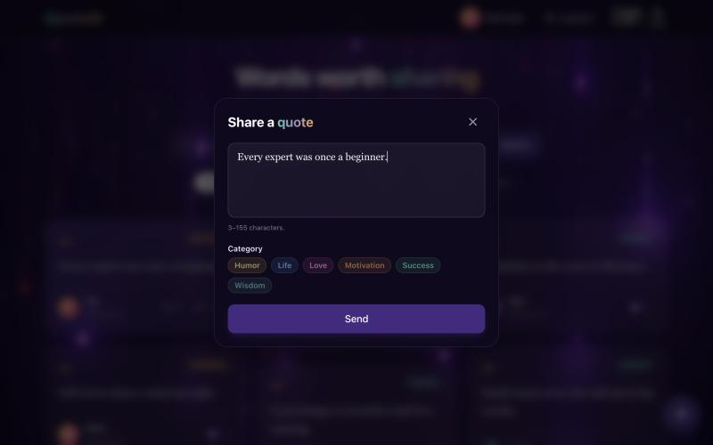
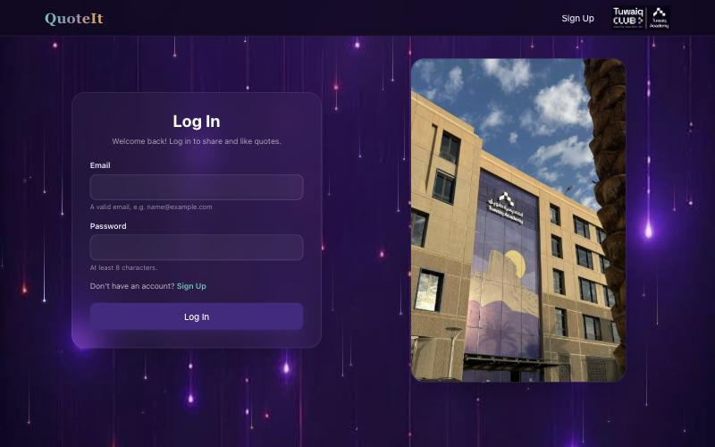
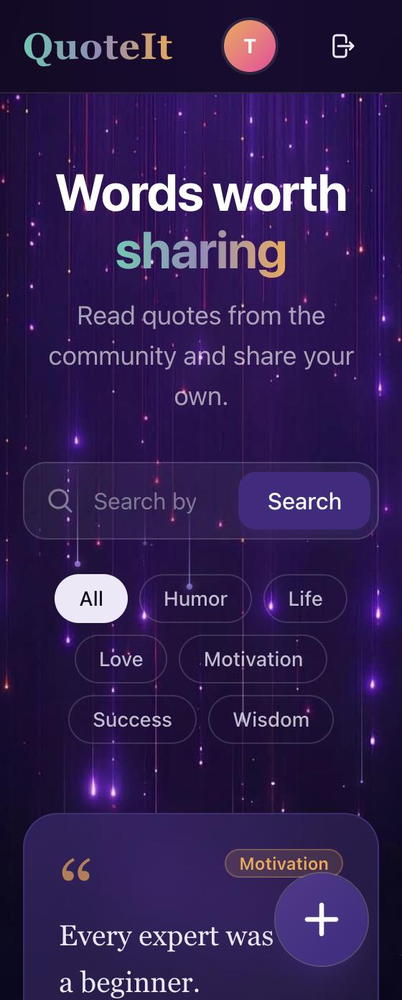
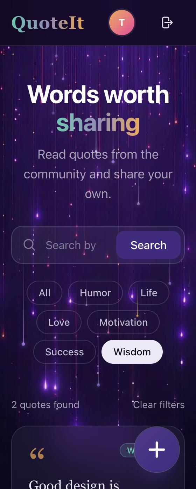
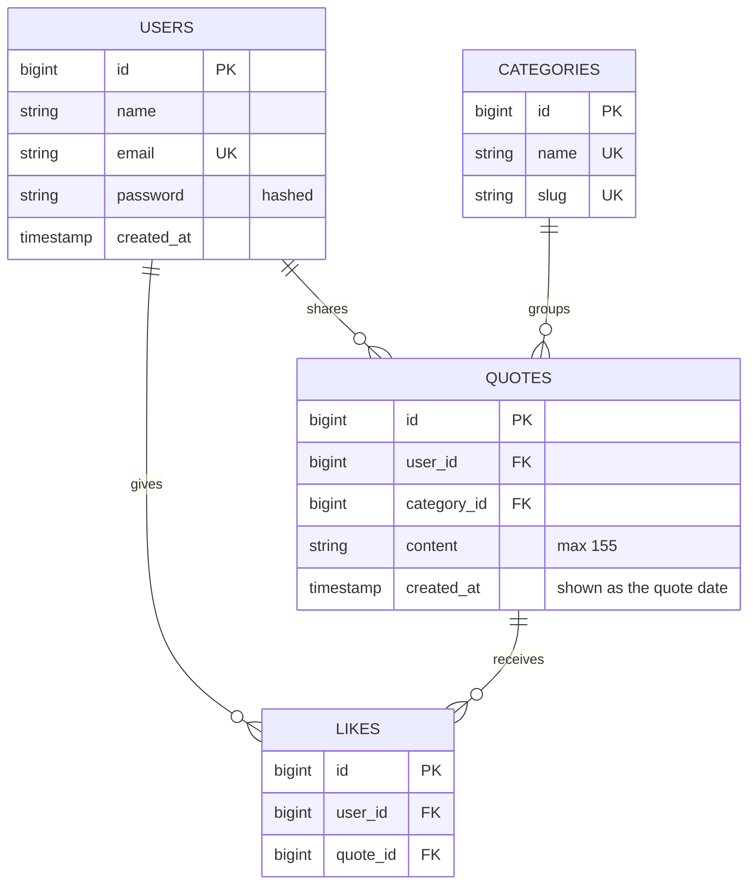

# QuoteIt ✨

**Words worth sharing.** QuoteIt is a simple website where anyone can read quotes shared by the community, and registered users can share, edit, delete, and like quotes.

Built during the **Tuwaiq Club bootcamp** (Tuwaiq Academy × Umm Al-Qura University), following the full software development life cycle: requirements (SRS) → database design → front-end → back-end → testing.



---

## Table of contents

- [Features](#features)
- [Screenshots](#screenshots)
- [Tech stack](#tech-stack)
- [Getting started](#getting-started)
- [Database design](#database-design)
- [Routes](#routes)
- [Project structure](#project-structure)
- [Validation rules](#validation-rules)
- [Security](#security)
- [Testing](#testing)
- [Design](#design)
- [Requirements traceability](#requirements-traceability)

---

## Features

### Core features (from the SRS)

| ID | Feature | Who |
|---|---|---|
| FR-01 | Browse every quote with its text, author, and date | Everyone, including guests |
| FR-02 | Sign up with name, email, and password | Guests |
| FR-03 | Log in with email and password | Registered users |
| FR-04 | Log out | Logged-in users |
| FR-05 | Share a quote (3–155 characters) | Logged-in users |
| FR-06 | Edit **only your own** quotes | Logged-in users |
| FR-07 | Delete **only your own** quotes | Logged-in users |

### Added features

| Feature | Description |
|---|---|
| ❤️ **Likes** | Like or unlike any quote. Each card shows the number of likes, and the heart turns purple when you liked it. Guests see the count and are sent to log in if they press it. |
| 👤 **Profile page** | Every user has a page (`/users/{id}`) with their name, join date, number of quotes, total likes received, and all their quotes. Click any name or avatar to open it. |
| 🔍 **Search** | Search quotes by their text **or** by the author's name. |
| 🏷️ **Categories** | Every quote belongs to one of six categories: Motivation, Wisdom, Life, Love, Success, Humor. Filter the feed by category, and combine it with search. |
| 🌌 **Animated background** | Glowing streaks of light fall over the background. The animation turns off automatically for users who enable "Reduce motion". |

---

## Screenshots

| Home (desktop) | Profile |
|---|---|
|  |  |

| Share a quote | Log in |
|---|---|
|  |  |

| Mobile: home | Mobile: category filter |
|---|---|
|  |  |

---

## Tech stack

| Layer | Technology |
|---|---|
| Language | PHP 8.3+ |
| Framework | Laravel 13 (MVC) |
| Views | Blade templates and components |
| Styling | Tailwind CSS 4 |
| Bundler | Vite |
| Database | SQLite (local development); designed to run on PostgreSQL (Supabase) |
| Tests | Pest |
| Code style | Laravel Pint |

---

## Getting started

### Requirements

- PHP 8.3 or newer
- Composer
- Node.js and npm

On macOS you can install all three with [Homebrew](https://brew.sh):

```bash
brew install php composer node
```

### Installation

```bash
# 1. Clone the repository
git clone https://github.com/<your-username>/tuwaiq-bootcamp.git
cd tuwaiq-bootcamp

# 2. Install PHP and JavaScript dependencies
composer install
npm install

# 3. Create the environment file and app key
cp .env.example .env
php artisan key:generate

# 4. Create the SQLite database, run the migrations, and add sample data
touch database/database.sqlite
php artisan migrate --seed

# 5. Build the front-end assets
npm run build

# 6. Start the server
php artisan serve
```

Open **http://localhost:8000**.

> 💡 While working on the design, run `npm run dev` in a second terminal so CSS and JS changes show up instantly.

### Sample data

`php artisan migrate --seed` creates:

- **6 categories**: Motivation, Wisdom, Life, Love, Success, Humor
- **5 users**: a test account (`test@example.com`) plus Lujain, Sara, Zahra, and Maha
- **8 sample quotes** with random likes

The test account's password is the default in [`database/factories/UserFactory.php`](database/factories/UserFactory.php). You can also create your own account from the **Sign Up** page.

> ⚠️ `php artisan migrate:fresh --seed` **deletes all data**, including accounts you created, and rebuilds the sample data.

---

## Database design

Four main tables. Each entity became a table and each attribute a column, following the workshop steps: **Requirements → ERD → Relational schema → Constraints**.



### Relationships

| Relationship | Type | How it is stored |
|---|---|---|
| User → Quotes | **One-to-Many (1:N)** | `quotes.user_id → users.id` |
| Category → Quotes | **One-to-Many (1:N)** | `quotes.category_id → categories.id` |
| Users ↔ Quotes (likes) | **Many-to-Many (M:N)** | Junction table `likes (user_id, quote_id)` |

### Integrity constraints

| Constraint | Where | What it prevents |
|---|---|---|
| `PRIMARY KEY` | `id` in every table | Two records with the same identity |
| `FOREIGN KEY` | `quotes.user_id`, `quotes.category_id`, `likes.user_id`, `likes.quote_id` | A quote or like pointing to a user, category, or quote that doesn't exist |
| `UNIQUE` | `users.email` | Two accounts with the same email |
| `UNIQUE` | `likes (user_id, quote_id)` | The same person liking the same quote twice |
| `NOT NULL` | `users.name`, `users.email`, `quotes.content` | Missing required data |

### Referential actions

| When this is deleted… | …this happens | Action |
|---|---|---|
| A user | All their quotes and likes are deleted | `CASCADE` |
| A quote | Only that quote and its likes are deleted; the user's other quotes stay | `CASCADE` |
| A category | Blocked while quotes still use it | `RESTRICT` |

Migrations live in [`database/migrations`](database/migrations).

---

## Routes

| Method | URL | Name | Access | Action |
|---|---|---|---|---|
| GET | `/` | `home` | Everyone | Quote feed (supports `?search=` and `?category=`) |
| GET | `/users/{user}` | `users.show` | Everyone | Profile page |
| GET | `/signup` | `signup` | Guests | Sign up form |
| POST | `/signup` | | Guests | Create account |
| GET | `/login` | `login` | Guests | Log in form |
| POST | `/login` | | Guests | Log in |
| POST | `/logout` | `logout` | Logged in | Log out |
| POST | `/quotes` | `quotes.store` | Logged in | Share a quote |
| PUT | `/quotes/{quote}` | `quotes.update` | Owner only | Edit a quote |
| DELETE | `/quotes/{quote}` | `quotes.destroy` | Owner only | Delete a quote |
| POST | `/quotes/{quote}/like` | `quotes.like` | Logged in | Like or unlike a quote |

---

## Project structure

```
app/
├── Http/
│   ├── Controllers/
│   │   ├── QuoteController.php            # Feed, share, edit, delete
│   │   ├── LikeController.php             # Like / unlike
│   │   ├── ProfileController.php          # Profile page
│   │   ├── RegisteredUserController.php   # Sign up
│   │   └── SessionController.php          # Log in / log out
│   └── Requests/                          # Form validation
│       ├── RegisterUserRequest.php
│       ├── LogInRequest.php
│       └── QuoteRequest.php
├── Models/
│   ├── User.php        # hasMany quotes, belongsToMany likedQuotes
│   ├── Quote.php       # belongsTo user & category, belongsToMany likers
│   └── Category.php    # hasMany quotes
└── Policies/
    └── QuotePolicy.php # Only the owner can edit or delete

database/
├── migrations/         # Table definitions
├── factories/          # Fake data for tests
└── seeders/            # Sample data

resources/
├── css/app.css         # Tailwind theme (Tuwaiq colours) and shared styles
├── js/
│   ├── app.js
│   └── light-rain.js   # Animated background
└── views/
    ├── Layout/         # Page layouts
    ├── Authentication/ # Sign up & log in pages
    ├── components/     # navbar, quote-card, avatar, category-picker, share-quote
    ├── welcome.blade.php   # Home page
    └── profile.blade.php   # Profile page

routes/web.php          # All routes
tests/Feature/          # Automated tests
```

### MVC flow

```
Request → Route → Controller → Model (database) → View (Blade) → Response
```

Example: pressing **Send** in the share popup sends `POST /quotes` → `QuoteController@store` validates it with `QuoteRequest` → creates the quote through the `User → quotes` relationship → redirects to the home page.

---

## Validation rules

Every rule is checked **in the browser** (instant hints under each field) **and on the server** (so it can't be bypassed).

| Field | Rule | Error shown |
|---|---|---|
| Name | Required, 2–50 characters, letters and spaces only | Under the field |
| Email | Required, valid format, not already registered | "This email is already registered." |
| Password | Required, at least 8 characters | Under the field |
| Quote | Required, 3–155 characters | Inside the share popup |
| Category | Required, must exist | "Please choose a category." |
| Log in | Email and password must match an account | "The email or password is incorrect." |

---

## Security

| Concern | How it is handled |
|---|---|
| Passwords | Stored **hashed** (bcrypt), never as plain text (NFR-02) |
| Ownership | `QuotePolicy` lets only the owner edit or delete a quote. Anyone else gets **403 Forbidden** (NFR-03) |
| Guests | Share, edit, delete, like, and log out require login. Guests are redirected to the log in page |
| CSRF | Every form includes a CSRF token (`@csrf`) |
| XSS | Blade's `{{ }}` escapes all output automatically |
| Sessions | The session is regenerated on log in and invalidated on log out |

---

## Testing

```bash
php artisan test
```

**38 tests** cover:

| File | What it checks |
|---|---|
| `AuthenticationTest` | Sign up (valid and invalid fields, duplicate email, hashed password), log in, wrong password, log out |
| `QuoteTest` | Guest view, sharing, length limits, categories, editing and deleting your own quotes, **not** editing or deleting someone else's, search, category filter |
| `LikeTest` | Like, unlike, like counts, guests can't like, likes removed with their quote |
| `ProfileTest` | Profile stats and quotes, owner-only options, unknown profile returns 404 |
| `QuoteDatabaseTest` | Database constraints: 1:N relationship, FOREIGN KEY, NOT NULL, UNIQUE, CASCADE |

Format the code with:

```bash
vendor/bin/pint
```

---

## Design

- **Colours:** Tuwaiq Club palette: purple `#432a80`, orange `#f2a54a`, teal `#4fc9b0`, on a dark night background `#10081f`.
- **Glass cards:** semi-transparent cards with a blur so the animated background shows through. Your own quotes are highlighted in purple.
- **Typography:** Instrument Sans for the interface, Georgia (serif) for the quotes.
- **Avatars:** the first letter of the user's name on a colour gradient.
- **Responsive:** 3 columns on desktop, 2 on tablets, 1 on phones.
- **Accessibility:** labels on every input and icon button, visible focus rings, and the background animation respects "Reduce motion".

---

## Requirements traceability

How each user story in the SRS maps to the code and its tests:

| User story | Implemented in | Tested in |
|---|---|---|
| US-01 View all quotes as a guest | `QuoteController@index`, `welcome.blade.php` | `QuoteTest` |
| US-02 Sign up | `RegisteredUserController`, `RegisterUserRequest` | `AuthenticationTest` |
| US-03 Log in | `SessionController@store` | `AuthenticationTest` |
| US-04 Log out | `SessionController@destroy` | `AuthenticationTest` |
| US-05 Share a quote | `QuoteController@store`, `share-quote` component | `QuoteTest` |
| US-06 Edit my quote | `QuoteController@update`, `QuotePolicy` | `QuoteTest` |
| US-07 Delete my quote | `QuoteController@destroy`, `QuotePolicy` | `QuoteTest`, `QuoteDatabaseTest` |

---

## Acknowledgements

Built with the guidance of the Tuwaiq Club workshops:

- **How to turn your idea into a complete software solution:** SDLC, requirements, user stories, SRS
- **Database Design & Relational Data Modeling:** ERD, relational schema, constraints
- **Code To Click:** front-end with Laravel and Blade
- **Building the Hidden Engines of Applications:** back-end, HTTP, authentication, and authorisation
